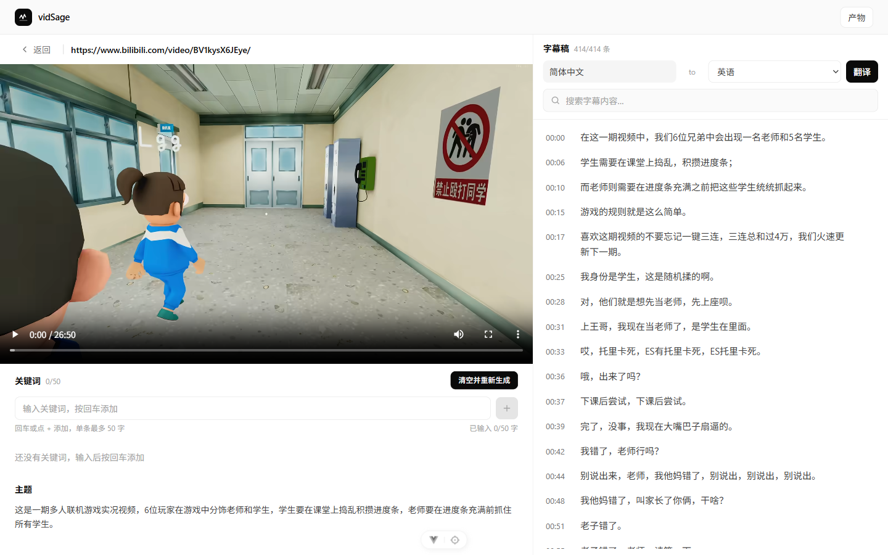
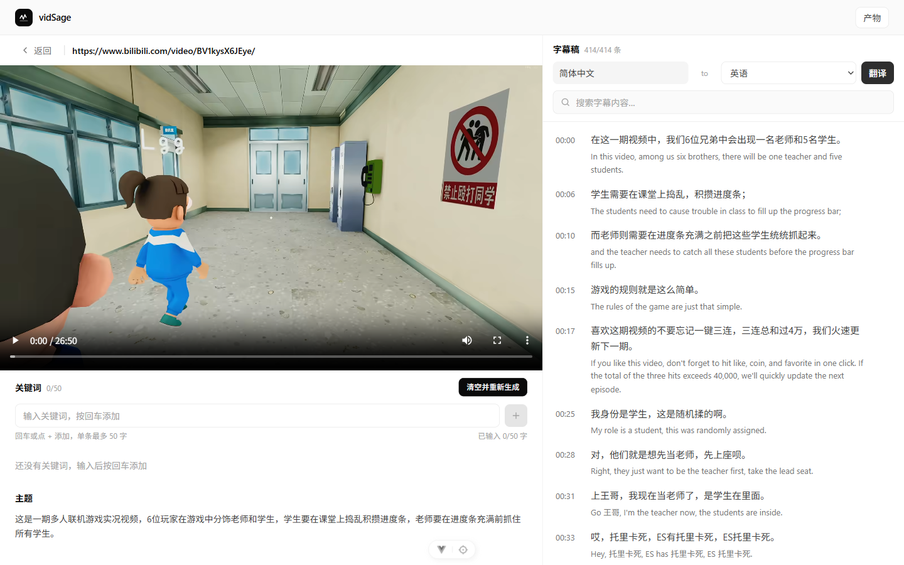
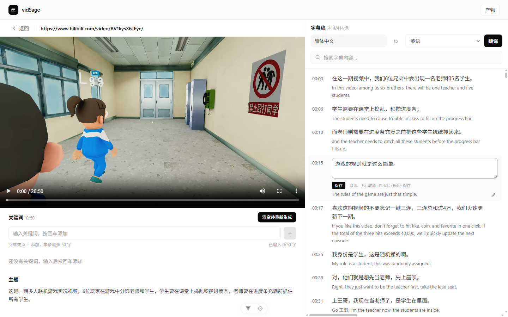
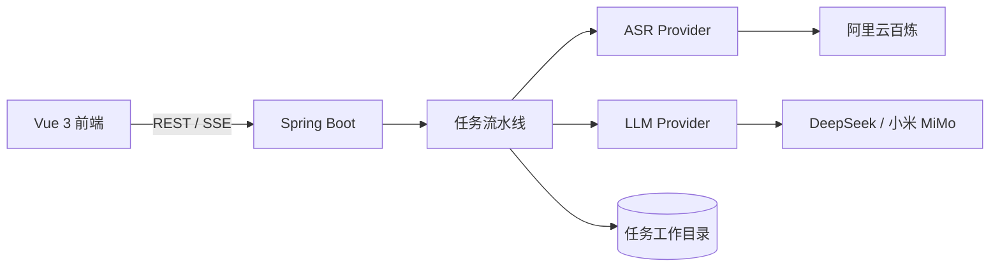

# vidSage

> 把视频变成可检索、可翻译的字幕稿。

vidSage 是一个视频知识助手：上传本地视频 / 音频，或粘贴视频链接，自动完成 **语音转写 → 字幕清洗 → 多语种翻译**，并在工作区里把视频、字幕、关键词与主题放在一起，边看边查、随时导出。

## 功能

- **双入口**：本地文件拖拽上传，或粘贴视频链接（由 yt-dlp 下载）
- **自动转写**：接入 DashScope 云端语音识别，输出带时间戳的分段字幕
- **字幕清洗**：LLM 修正错字、标点与断句，统一专有名词；带相似度守卫，防止模型改过头
- **多语言翻译**：分批翻译并携带跨批上下文，让术语与称谓全片一致；内置术语官方译名查证
- **联动工作区**：视频 / 音频播放与字幕同步，支持字幕搜索、双语对照、逐句纠错
- **关键词与主题**：关键词会参与清洗，主题摘要由 LLM 从字幕上下文中提炼
- **产物导出**：原文 / 清洗 / 译文的 SRT 与 JSON 均可直接下载
- **异步任务**：并发闸门限流、SSE 实时进度、进程异常退出后的任务收口与重新清洗 / 重新翻译

## 界面

清洗完成后，左侧是播放器、关键词与主题，右侧是清洗后的字幕稿。



选好目标语种点「翻译」，原文与译文逐句对照显示。



任何一句都能点铅笔就地修改——错字、断句或译文不准确，改完保存即可。



> 截图来自本地运行示例，示例视频为 B 站公开内容。

## 技术栈

| 层 | 技术 |
|---|---|
| 后端 | Java 21 · Spring Boot 4.1 · Spring AI 2.0 · MyBatis-Plus · MySQL 8 |
| 前端 | Vue 3.5 · TypeScript · Vite 8 · Pinia · Tailwind CSS 4 |
| 媒体处理 | ffmpeg / ffprobe · yt-dlp |
| 模型 | DashScope ASR（云端）· DeepSeek Chat / 小米 MiMo（OpenAI 兼容） |
| 接口 | REST + SSE · SpringDoc OpenAPI |

## 架构

- 后端按 `domain / application / infrastructure / web` 四层拆分；ASR 走 `ASRProvider` 抽象，LLM 通过 Spring AI 在 DeepSeek 与小米 MiMo 之间按配置切换。
- 一次提交对应一条任务流水线，阶段状态落在 `task_run` / `subtitle_artifact` 等表里；SSE 把进度实时推给前端，启动时会把上个进程遗留的 RUNNING 任务收口成 INTERRUPTED。
- 前端是 Vue 单页应用：上传页与工作区两个主页面，dev 环境由 Vite 把 `/api` 反向代理到后端。



## 快速开始

### 环境要求

- JDK 21、Maven 3.9+
- Node.js `^22.18.0` 或 `>=24.12.0`
- MySQL 8.0+
- ffmpeg、ffprobe（在 PATH 中，或在配置里写绝对路径）
- yt-dlp（链接入口需要；可放在 `tools/` 下，或用 `YT_DLP_PATH` 指定，未配置时从 PATH 查找）

### 1. 准备数据库

```sql
CREATE DATABASE vidsage DEFAULT CHARACTER SET utf8mb4 COLLATE utf8mb4_0900_ai_ci;
```

后端启动时会自动执行 `backend/src/main/resources/schema.sql` 建表，不需要手工导入。

### 2. 本地配置

仓库**不包含** `application-local.yml`（里面有密钥和本机路径，按机器各自维护）。在 `backend/src/main/resources/` 下新建该文件：

```yaml
spring:
  datasource:
    url: jdbc:mysql://localhost:3306/vidsage?useUnicode=true&characterEncoding=utf8&serverTimezone=UTC&allowMultiQueries=true
    username: root
    password: your-password
  ai:
    deepseek:
      api-key: your-deepseek-key
    openai:
      api-key: your-mimo-key

vidsage:
  asr:
    dashscope:
      api-key: your-dashscope-key
  tools:
    ffmpeg-path: /path/to/ffmpeg
    ffprobe-path: /path/to/ffprobe
    # yt-dlp-path: /path/to/yt-dlp
```

也可以用环境变量覆盖：`DASHSCOPE_API_KEY`、`DEEPSEEK_API_KEY`、`MIMO_API_KEY`、`FFMPEG_PATH`、`FFPROBE_PATH`、`YT_DLP_PATH`、`YT_DLP_COOKIES_FILE`、`VIDSAGE_WORKSPACE_ROOT`。

### 3. 启动后端

```bash
cd backend
mvn spring-boot:run
```

默认监听 `http://localhost:8080`。接口文档在 `http://localhost:8080/swagger-ui.html`。

### 4. 启动前端

```bash
cd frontend
npm install
npm run dev
```

打开 `http://localhost:5173`。dev 下 `/api` 由 Vite 代理到 `localhost:8080`；生产环境由部署层反向代理。

## 目录结构

```
vidSage/
├── backend/     # Spring Boot 后端（domain / application / infrastructure / web 四层）
├── frontend/    # Vue 3 前端
├── docs/        # 文档与界面截图
├── tools/       # 外部工具与辅助脚本
└── .trellis/    # 开发流程、规范与任务档案
```

## 已知限制

- 需要自备 MySQL、DashScope ASR Key 与 LLM Key（DeepSeek 或小米 MiMo），仓库不提供任何密钥。
- URL 上传目前只支持 B 站视频页链接；其他站点没有适配和验证。
- 面向单用户本地部署，暂未做账号、权限与多租户。
- 转写与翻译效果取决于所配置的 ASR / LLM 供应商；供应商异常时，译文可能退回原文。
- 设计原型与本地 ASR 实验代码不随仓库发布。

## 许可证

代码以 [MIT 许可证](LICENSE) 发布，Copyright (c) 2026 HeQiu。

README 与界面截图中的展示媒体（`docs/images/`）来自互联网，仅用于学习与演示，**不在上述 MIT 授权范围内**；如有侵权，请联系删除。

本项目是个人练手项目，许多地方做得不到位，欢迎提 issue。
